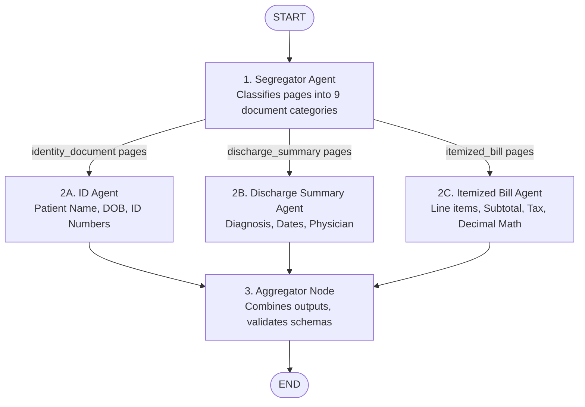

# Medical Claim Document Processing Pipeline

[](https://superclaims-project.onrender.com/)
[](https://superclaims-project.onrender.com/docs)
[](https://github.com/divyaaax/superclaims)
[](https://www.python.org/)

An intelligent, multi-agent medical claim processing backend built with **FastAPI**, **LangGraph**, **Pydantic v2**, and **pypdf**.

- **Live Web Dashboard**: [https://superclaims-project.onrender.com/](https://superclaims-project.onrender.com/)
- **Interactive Swagger Documentation**: [https://superclaims-project.onrender.com/docs](https://superclaims-project.onrender.com/docs)
- **Live Health Check**: [https://superclaims-project.onrender.com/health](https://superclaims-project.onrender.com/health)

This service ingests multi-page medical claim PDFs, extracts text page-by-page while preserving physical page numbering, segregates pages into **exactly 9 document categories** using an AI Segregator Agent, routes relevant pages in parallel to three specialized extraction agents (ID Agent, Discharge Summary Agent, and Itemized Bill Agent), performs monetary reconciliation with `Decimal` arithmetic, and aggregates the results into a validated JSON response.

---

## Architecture and Workflow

The pipeline implements an asynchronous state graph orchestrated by **LangGraph**. The workflow strictly routes only relevant pages to extraction agents without passing unnecessary pages or whole documents.



---

## Document Categories

The Segregator Agent classifies each page into one of 9 discrete document categories:

| Category | Description | Example Content / Page |
| :--- | :--- | :--- |
| `claim_forms` | Insurance claim reimbursement forms & initial application records | Page 1 |
| `cheque_or_bank_details` | Bank cheques, account slips, routing & bank verification forms | Page 2 |
| `identity_document` | Government-issued IDs, driver's licenses, passports, DMV cards | Page 3 |
| `itemized_bill` | Itemized hospital bills detailing room charges, medical procedures, supplies, rates | Page 9 |
| `discharge_summary` | Clinical hospital course, admission/discharge dates, diagnosis, and physician notes | Page 4 |
| `prescription` | Doctor's medication orders, dosages, directions, and pharmacy prescriptions | Page 5, 10 |
| `investigation_report` | Diagnostic pathology reports, complete blood count (CBC), metabolic & lipid panels | Page 6, 11, 12 |
| `cash_receipt` | Cashier receipts, payment acknowledgment slips, and cash transaction records | Page 7 |
| `other` | Consents, appointment letters, blank questionnaires, clinical referrals | Page 8, 13, 14, 16, 17, 18 |

---

## Agent Responsibilities

### 1. Segregator Agent
- **Input**: Page-level extracted text and physical page numbers (1-indexed).
- **Function**: Uses an LLM with structured outputs to classify pages in manageable batches (default batch size: 5 pages). Empty or low-text pages are flagged as `other` immediately without wasting LLM tokens.
- **Output**: `SegregationSummary` mapping each document type to an ordered list of 1-indexed page numbers.

### 2. ID Agent
- **Input**: *Only* pages classified as `identity_document`.
- **Function**: Extracts patient legal name, date of birth, identification numbers (ID number, ID type), and policy details if explicitly present.
- **Rules**: Does not invent or hallucinate missing data. Missing values remain `null`.

### 3. Discharge Summary Agent
- **Input**: *Only* pages classified as `discharge_summary`.
- **Function**: Extracts primary diagnosis, admission date, discharge date, attending physician details, hospital name, and discharge condition.
- **Rules**: Preserves exact medical terminology and handles missing values cleanly.

### 4. Itemized Bill Agent
- **Input**: *Only* pages classified as `itemized_bill`.
- **Function**: Extracts all line-item charges (description, quantity, unit price, line amount, date), stated subtotal, stated tax, and stated total.
- **Reconciliation**: Uses Python **`Decimal`** arithmetic to sum line items and verify against stated totals. If line items and stated totals disagree, `discrepancy_detected` is flagged with full details—the stated total is **never** silently overwritten.

### 5. Aggregator Node
- **Input**: Results from all three extraction branches and segregation summary.
- **Function**: Combines all outputs into a single unified JSON model (`ClaimProcessingResponse`), validates data with Pydantic, calculates total pipeline latency, and records any non-fatal warnings or error messages.

---

## Prerequisites

- **Python**: Version 3.10+ (tested and verified on Python 3.14).
- **Operating System**: Windows, macOS, or Linux.
- **Git** (optional).

---

## Quickstart Guide

### 1. Clone or Open the Workspace
```powershell
cd c:\superclaims
```

### 2. Set Up Virtual Environment
```powershell
# Create virtual environment
python -m venv .venv

# Activate on Windows (PowerShell)
.\.venv\Scripts\Activate.ps1

# (Or on Linux / macOS: source .venv/bin/activate)
```

### 3. Install Dependencies
```powershell
pip install -r requirements.txt
```

### 4. Configure Environment Variables
Copy `.env.example` to `.env`:
```powershell
Copy-Item .env.example .env
```

Edit `.env` to configure your settings:
```ini
# OpenAI or compatible provider API Key (OpenAI, Groq, OpenRouter, vLLM, Ollama)
OPENAI_API_KEY=your_openai_api_key_here

# Model to use (gpt-4o-mini, gpt-4o, etc.)
LLM_MODEL=gpt-4o-mini
LLM_TEMPERATURE=0.0

# Set to true for offline evaluation without an external API key:
USE_MOCK_LLM=false

# Upload limits
MAX_FILE_SIZE_MB=25
BATCH_SIZE=5
LOG_LEVEL=INFO
```

> **Note on AI Keys:** The service strictly enforces security:
> - If `OPENAI_API_KEY` is not provided and `USE_MOCK_LLM=false`, the API returns a clear **HTTP 503 Service Unavailable** error explaining that credentials must be set.
> - Setting `USE_MOCK_LLM=true` allows full offline evaluation, automated testing, and demonstration without network calls or API costs.

---

## Running the Application

Start the FastAPI application using `uvicorn`:

```powershell
uvicorn app.main:app --reload --host 127.0.0.1 --port 8000
```

Once running:
- **Interactive Web Dashboard**: [http://127.0.0.1:8000/](http://127.0.0.1:8000/) *(Full visual UI with drag-and-drop PDF upload, one-click sample evaluation, visual 9-category page badges, clinical & financial summary cards, and live JSON inspector)*
- **Interactive Swagger Documentation**: [http://127.0.0.1:8000/docs](http://127.0.0.1:8000/docs)
- **ReDoc Alternative Documentation**: [http://127.0.0.1:8000/redoc](http://127.0.0.1:8000/redoc)
- **Health Check Endpoint**: [http://127.0.0.1:8000/health](http://127.0.0.1:8000/health)

---

## Cloud Deployment Guide (Render / Railway / Fly.io)

This repository includes turnkey configuration files (`Dockerfile`, `render.yaml`, `Procfile`) for immediate zero-config deployment:

### 1. Deploy on Render
1. Push this repository to GitHub.
2. Sign in to [Render](https://render.com) and click **New + > Blueprint**.
3. Select your repository. Render will automatically detect `render.yaml` and configure the Web Service with Python 3.11 and Uvicorn.
4. (Optional) Set `OPENAI_API_KEY` in Render's Environment Variables if using live LLM inference, or leave `USE_MOCK_LLM=true` for free offline demonstration.

### 2. Deploy on Railway
1. Sign in to [Railway](https://railway.app) and click **New Project > Deploy from GitHub repo**.
2. Select `divyaaax/superclaims`. Railway automatically detects the `Procfile` and `requirements.txt`.
3. Set environment variable `PORT` to `8000` (or allow Railway's assigned port).

### 3. Deploy via Docker (Local or Fly.io)
```bash
# Build Docker image
docker build -t superclaims .

# Run Docker container
docker run -p 8000:8000 --env USE_MOCK_LLM=true superclaims
```


---

## API Documentation and Usage

### 1. Health Check
```bash
curl -X GET http://127.0.0.1:8000/health
```
**Response**:
```json
{
  "status": "ok",
  "service": "Claim Processing Pipeline",
  "version": "1.0.0",
  "llm_configured": true,
  "llm_model": "gpt-4o-mini",
  "use_mock_llm": false
}
```

### 2. Process Claim Document
Submit a multi-part form with `claim_id` and the PDF file:

```bash
curl -X POST http://127.0.0.1:8000/api/process \
  -F "claim_id=CLM-2024-789456" \
  -F "file=@data/sample_medical_claim.pdf"
```

Or via Python `httpx`:
```python
import httpx

with open("data/sample_medical_claim.pdf", "rb") as f:
    response = httpx.post(
        "http://127.0.0.1:8000/api/process",
        data={"claim_id": "CLM-2024-789456"},
        files={"file": ("sample.pdf", f, "application/pdf")},
        timeout=60.0,
    )
print(response.json())
```

---

## Example JSON Response

Below is a truncated view of the response returned when processing `data/sample_medical_claim.pdf` (full sample saved at `data/example_response.json`):

```json
{
  "claim_id": "CLM-2024-789456",
  "status": "SUCCESS",
  "processing_time_seconds": 0.039,
  "segregation_results": {
    "total_pages": 18,
    "categories": {
      "claim_forms": [1],
      "cheque_or_bank_details": [2],
      "identity_document": [3],
      "discharge_summary": [4],
      "prescription": [5, 10],
      "investigation_report": [6, 11, 12],
      "cash_receipt": [7],
      "itemized_bill": [9],
      "other": [8, 13, 14, 15, 16, 17, 18]
    },
    "page_classifications": [
      {
        "page_number": 1,
        "document_type": "claim_forms",
        "confidence": 0.95,
        "reasoning": "Identified claim form header"
      },
      {
        "page_number": 3,
        "document_type": "identity_document",
        "confidence": 0.95,
        "reasoning": "Government ID Card"
      },
      {
        "page_number": 4,
        "document_type": "discharge_summary",
        "confidence": 0.95,
        "reasoning": "Hospital Discharge Summary"
      },
      {
        "page_number": 9,
        "document_type": "itemized_bill",
        "confidence": 0.95,
        "reasoning": "Itemized Hospital Bill"
      }
    ]
  },
  "extracted_data": {
    "identity_information": {
      "patient_name": "JOHN MICHAEL SMITH",
      "date_of_birth": "15-MAR-1985",
      "id_numbers": {
        "id_number": "ID-987-654-321",
        "id_type": "Government ID Card"
      },
      "policy_details": null,
      "gender": "Male",
      "address": "456 Oak Street, Apt 12B, Springfield, IL 62701",
      "source_pages": [3],
      "extracted": true
    },
    "discharge_summary": {
      "diagnosis": "Community Acquired Pneumonia (CAP)",
      "admission_date": "January 20, 2025",
      "discharge_date": "January 25, 2025",
      "physician_details": {
        "name": "Dr. Sarah Johnson, MD",
        "title": "Attending Physician"
      },
      "hospital_name": "City Medical Center",
      "discharge_condition": "Stable, improved",
      "discharge_medications": [
        "Amoxicillin 500mg TID x 7 days",
        "Acetaminophen 500mg PRN for pain"
      ],
      "source_pages": [4],
      "extracted": true
    },
    "itemized_bill": {
      "bill_number": "BILL-2025-789456",
      "bill_date": "February 1, 2025",
      "bill_items": [
        {
          "item_description": "Room Charges - Semi-Private (5 days)",
          "quantity": 5.0,
          "unit_price": 200.0,
          "amount": 1000.0,
          "service_date": "01/20/25"
        },
        {
          "item_description": "Admission Fee",
          "quantity": 1.0,
          "unit_price": 150.0,
          "amount": 150.0,
          "service_date": "01/20/25"
        },
        {
          "item_description": "CT Scan - Chest",
          "quantity": 1.0,
          "unit_price": 800.0,
          "amount": 800.0,
          "service_date": "01/21/25"
        }
      ],
      "stated_subtotal": 6113.0,
      "stated_tax": 305.65,
      "stated_total": 6418.65,
      "calculated_subtotal": 6113.0,
      "calculated_total": 6418.65,
      "discrepancy_detected": false,
      "discrepancy_details": null,
      "source_pages": [9],
      "extracted": true
    }
  },
  "errors": []
}
```

---

## Running the Automated Tests

All tests are implemented using **Pytest** and do not require live external API keys. They run completely locally in ~1 second.

Run all tests:
```powershell
python -m pytest -v
```

### Test Suite Structure
| Test File | Description |
| :--- | :--- |
| `tests/test_health.py` | Health endpoint responses & LLM configuration status |
| `tests/test_pdf_processor.py` | Page extraction, empty PDF rejection, corrupted byte stream handling |
| `tests/test_schemas.py` | Validation of strict 9 categories, decimal precision, response models |
| `tests/test_agents.py` | Segregator batching, blank-page shortcuts, ID, Discharge, and Bill math |
| `tests/test_graph.py` | LangGraph workflow execution, concurrent branches, missing category handling |
| `tests/test_api.py` | POST /api/process endpoint validation, size limits (413), error handling |
| `tests/test_integration_sample.py` | End-to-end integration test on the real 18-page sample claim PDF |

---

## Repository Structure

```
superclaims/
├── app/
│   ├── agents/
│   │   ├── segregator.py          # Classifies pages into document categories
│   │   ├── id_agent.py            # Extracts patient identity and demographics
│   │   ├── discharge_agent.py     # Extracts diagnoses, admission/discharge dates, and physician notes
│   │   └── bill_agent.py          # Extracts itemized charges and performs Decimal reconciliation
│   ├── services/
│   │   └── llm_service.py         # ChatOpenAI structured output wrapper and mock fallback
│   ├── static/                    # Interactive dashboard frontend
│   │   ├── app.js                 # Dashboard logic, drag-and-drop, and API integration
│   │   ├── index.html             # Clean HTML5 UI
│   │   └── style.css              # Custom responsive stylesheet (Light & Dark modes)
│   ├── config.py                  # Pydantic Settings configuration
│   ├── graph.py                   # LangGraph StateGraph orchestration workflow
│   ├── main.py                    # FastAPI application and REST endpoints
│   ├── pdf_processor.py           # Per-page text extraction and validation
│   ├── schemas.py                 # Pydantic data models and schemas
│   └── state.py                   # TypedDict graph state definition
├── data/
│   ├── example_response.json      # Complete sample JSON response
│   └── sample_medical_claim.pdf   # 18-page sample claim package
├── tests/
│   ├── conftest.py                # Pytest fixtures and mock services
│   ├── test_agents.py             # Agent segregation and extraction tests
│   ├── test_api.py                # HTTP endpoint and validation tests
│   ├── test_graph.py              # LangGraph pipeline execution tests
│   ├── test_health.py             # Health check endpoint tests
│   ├── test_integration_sample.py # End-to-end integration test on 18-page sample
│   ├── test_pdf_processor.py      # PDF parsing and corrupted stream tests
│   └── test_schemas.py            # Schema validation and Decimal precision tests
├── Dockerfile                     # Container image definition
├── Procfile                       # Process file for Heroku/Railway
├── render.yaml                    # Infrastructure-as-code for Render deployment
├── requirements.txt               # Production and test dependencies
└── README.md                      # Project documentation
```

---

## Technical Highlights & Design Decisions

### 1. Decoupled Multi-Agent Graph (LangGraph)
Rather than passing an entire 18+ page claim document to a single monolithic prompt—which would suffer from context degradation, high hallucination rates, and massive token costs—the pipeline uses a directed acyclic state graph:
- **Segregator Node**: First classifies each physical page independently into one of 9 discrete document types.
- **Conditional Routing**: Extraction agents (ID, Discharge, Bill) run concurrently and receive *strictly* the pages belonging to their domain.
- **Aggregator Node**: Collects results from all branches, computes end-to-end latency, and validates the unified Pydantic response model.

### 2. High-Precision Financial Reconciliation
Medical bills often contain dozens of line items, rounding idiosyncrasies, and tax computations.
- The pipeline utilizes Python's native **`Decimal`** module with `ROUND_HALF_UP` quantization to prevent floating-point inaccuracies common with IEEE 754 floats.
- Stated totals on the document are **never silently modified or overwritten**. If the calculated sum of line items disagrees with the stated total, a `discrepancy_detected` flag is set to `true` along with line-by-line audit details.

### 3. Token-Efficient Fast-Paths
- Pages with negligible or zero text (e.g., blank separator pages, unreadable noise) automatically bypass the LLM and are categorized as `other`, preserving LLM quotas and minimizing latency.
- LLM calls for page segregation are batched (configurable via `BATCH_SIZE`), allowing large multi-page PDFs to be processed with minimal round-trip network overhead.

### 4. Zero-Dependency Offline Evaluation Mode
- For continuous integration and local development without incurring API costs or requiring external keys, setting `USE_MOCK_LLM=true` enables a deterministic fallback engine that executes all pipeline graph stages locally.

---

## Known Limitations and Future Improvements

1. **Scanned Images & OCR**: Current extraction uses `pypdf` for digital PDFs. For non-digital scanned physical documents or mobile phone photos, an OCR engine (such as Tesseract, AWS Textract, or Azure Document Intelligence) can be plugged directly into the modular `PDFProcessor`.
2. **Streaming Progress Updates**: For very large documents (100+ pages), integrating WebSockets or Server-Sent Events (SSE) would allow the client to observe real-time page-by-page progress.
3. **Database Persistence**: Intermediate graph state and extracted claims can be persisted to a relational database (PostgreSQL with SQLAlchemy) for historical audit trails.
